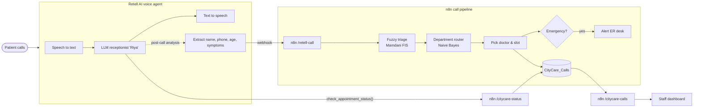
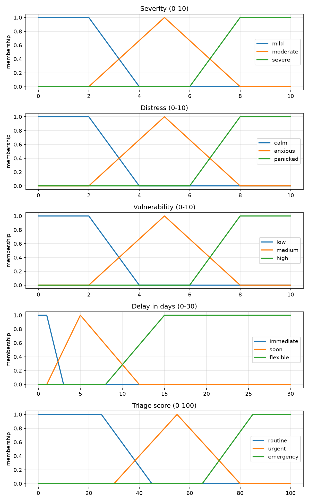
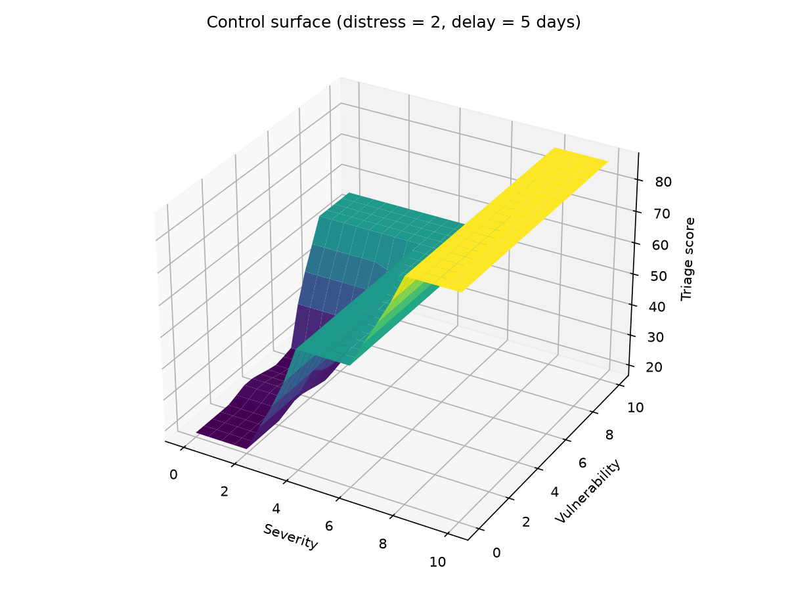
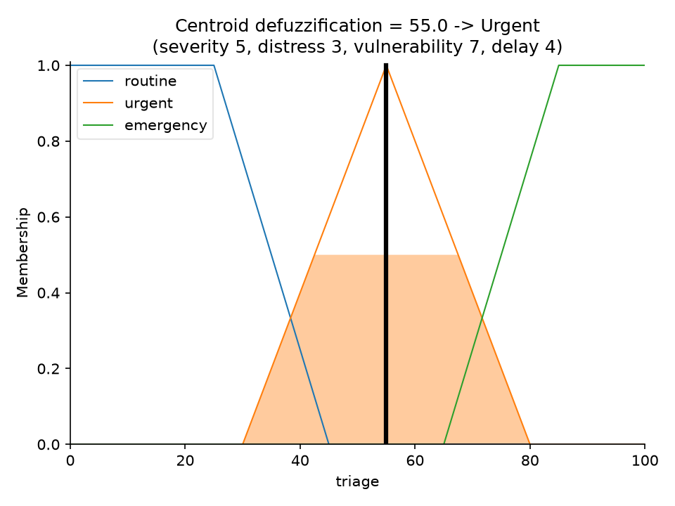
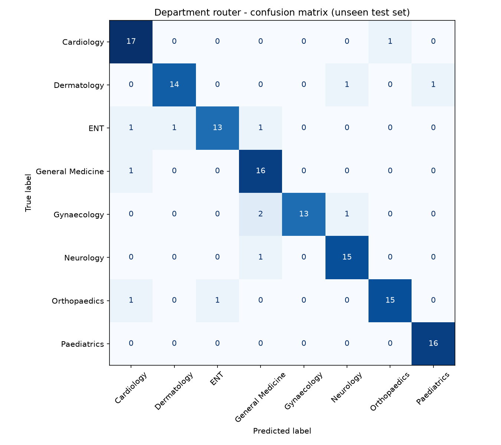

# CityCare Voice AI: an inbound AI receptionist with fuzzy triage

An AI voice receptionist for a (fictional) multi-speciality hospital. It answers patient phone calls in English or Hindi. After each call it:

- decides **how urgent** the call is using a **fuzzy logic** system,
- picks the right **department** using a **Naive Bayes** text classifier, and
- suggests a **doctor and time slot**, then saves everything for hospital staff.

Callers can also ask the agent whether their appointment is confirmed. Emergencies are flagged for the ER desk.

Built for the **Artificial Intelligence & Soft Computing** course project.

> ⚠️ Academic demo only. It does not give medical advice, and it is not a substitute for real triage or emergency services.

## Architecture



## AI & Soft Computing concepts used

| Concept | Where |
|---|---|
| Intelligent agent (PEAS) | The voice agent perceives speech and acts by replying and saving records |
| NLP / speech recognition / speech synthesis | Retell AI (speech-to-text, LLM, text-to-speech) |
| Information extraction | Post-call analysis pulls out name, age, symptoms and so on |
| **Fuzzy logic (soft computing)** | `fuzzy_triage/`: fuzzification, 15-rule Mamdani inference, centroid defuzzification |
| **Machine learning** | `department_router/`: Multinomial Naive Bayes on bag-of-words |
| Heuristics / knowledge representation | Weighted symptom lexicon, negation handling, expert rule base |
| Rule-based reasoning | Safety override: red-flag symptoms → Emergency department |

### 1. Fuzzy triage (`fuzzy_triage/`)

Crisp inputs are pulled from what the caller said, using a weighted keyword lexicon (`lexicon.json`).
Negations such as "no fever" are skipped, and longer phrases ("chest pain") are matched before shorter ones ("pain").

| Input | Range | Fuzzy sets |
|---|---|---|
| severity | 0–10 | mild, moderate, severe |
| distress | 0–10 | calm, anxious, panicked |
| vulnerability (age, pregnancy, chronic illness) | 0–10 | low, medium, high |
| delay (days until requested visit) | 0–30 | immediate, soon, flexible |
| **triage score (output)** | 0–100 | routine, urgent, emergency |

- 15 IF–THEN rules.
- AND is the minimum of the memberships; rules are combined with the maximum (Mamdani).
- The centroid method gives the final score:
  - below 40: **Routine**
  - 40–70: **Urgent**
  - above 70: **Emergency**

| Membership functions | Control surface | Defuzzification |
|---|---|---|
|  |  |  |

### 2. Department router (`department_router/`)

A Multinomial Naive Bayes classifier over 8 departments: Cardiology, Orthopaedics, Paediatrics, General Medicine, Gynaecology, Neurology, ENT and Dermatology.

- **Training data:** 1,136 sentences generated from symptom lists and everyday sentence templates (English and Hinglish).
- **Test data:** 132 separate, hand-written phrases that are never used for training.
- **Test accuracy: 90.2%.**



The routing has three cases:
- Emergency calls skip the classifier and go straight to the ER.
- If the caller names a department, that department is used.
- Otherwise the classifier decides.

### 3. Same models in n8n

n8n cloud runs JavaScript, not Python, so `n8n/build_code_nodes.py` **generates** the n8n Code nodes from the Python sources: the same lexicon, membership functions, rules and trained model weights. `n8n/check_parity.py` confirms that the JavaScript and Python versions give the same results.

## Features

1. **Hospital receptionist agent.** It knows the departments, doctor timings, visiting hours and emergency info, and works in English and Hindi. ([`retell/agent_prompt.md`](retell/agent_prompt.md))
2. **Safety override.** For red-flag symptoms, the agent tells the caller to call 108 or come to the ER straight away.
3. **Fuzzy triage** of every call.
4. **Department routing** with Naive Bayes.
5. **Doctor and slot suggestion.** Urgent calls get a slot within a day; routine calls get the day the caller asked for. Slots come from the `Doctors` table.
6. **Emergency alert** email to the ER desk. The node is included but disabled until an SMTP credential is added.
7. **Appointment status check** during a call, through a Retell custom function. It returns only the slot and status, never symptoms.
8. **Staff dashboard** (`dashboard/index.html`): calls sorted by urgency, protected by a dashboard key.

## Repository layout

```
fuzzy_triage/        Mamdani fuzzy inference system, samples, tests, plots
department_router/   Naive Bayes router, data generator, train/test data, evaluation
n8n/                 code-node generator, parity check, importable workflow JSON
retell/              agent prompt, extraction fields, custom function
dashboard/           static staff dashboard
docs/                project report
```

## Run it locally

```bash
python3 -m venv .venv && .venv/bin/pip install -r requirements.txt
.venv/bin/python fuzzy_triage/fuzzy_triage.py        # triage the sample calls
.venv/bin/python fuzzy_triage/test_triage.py         # tests
.venv/bin/python fuzzy_triage/plots.py               # regenerate graphs
.venv/bin/python department_router/generate_training_data.py
.venv/bin/python department_router/router.py "my knee hurts when I walk"
.venv/bin/python department_router/evaluate.py       # accuracy + confusion matrix
.venv/bin/python n8n/build_code_nodes.py             # regenerate n8n JavaScript
.venv/bin/python n8n/check_parity.py                 # JS == Python?
.venv/bin/python n8n/build_workflows.py              # regenerate importable workflows
```

## Deploy your own copy

1. **n8n**
   - Create two data tables:
     - `Doctors`: name, department, days (e.g. `Mon,Wed,Fri`), start_time, end_time.
     - `CityCare_Calls`: the columns written by the "Pick Doctor & Slot" node.
   - Import `n8n/workflow_call_pipeline.json` and `n8n/workflow_status_api.json`, and select your tables in the Data Table nodes.
   - In "Sort by Triage", replace `__SET_IN_N8N__` with a dashboard key of your choice.
   - Publish both workflows.
2. **Retell AI**
   - Create a single-prompt agent from `retell/agent_prompt.md`.
   - Add the post-call fields and the `check_appointment_status` custom function.
   - Point the agent webhook at your `/webhook/retell-call` URL.
3. **Dashboard:** open `dashboard/index.html`, enter your feed URL and dashboard key.

## Limitations

- The symptom lexicon and fuzzy rules are hand-tuned, not clinically validated.
- The router's training data is synthetic, so its accuracy on real calls would be lower than 90%.
- The webhook URLs are public; a production version would need signature checks on the Retell webhook.

## Future work

- Learn the membership functions from labelled calls (ANFIS / neuro-fuzzy), or tune them with a genetic algorithm.
- Replace keyword features with sentence embeddings.
- Real calendar booking and SMS confirmation.

## License

MIT
